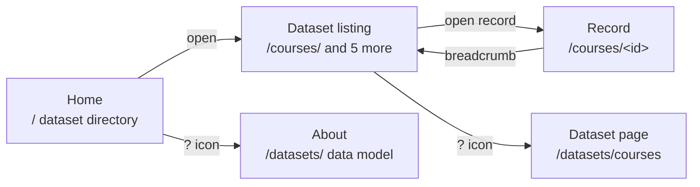

# EC2U Data Sites: Functionality Survey

Nov 5, 2026 · @Alessandro Bollini

Companion to [EC2U Data Site Mockup: References](https://claude.ai/artifact/3HcnVDNtQbj8dy2898KK1G).

## Scope

Two sites surveyed on 5 Nov 2026, through a browser session: the live Knowledge Hub at [data.ec2u.eu](https://data.ec2u.eu/) and its next version on the local Vite dev server at `http://localhost:5173/`. Where the two differ, the dev version is the functional reference. Its contextual help is known to be incomplete, so gaps there are recorded as gaps, not as design intent.

## Site map

The live site has five page types; help is a separate page reached by the `?` icon, never shown in place.

## Home and navigation

The live home page is a dataset directory, not a search page: one row per dataset with its record count, title and description. Totals are shown in the UI (the JSON-LD root omits them).

| Dataset | Records (5 Nov 2026) |
| --- | --- |
| Courses | 9,333 |
| Units | 1,596 |
| Programs | 994 |
| Events | 344 |
| Documents | 92 |
| Universities | 9 |

- **Shell:** two-pane layout. Left rail holds the EC2U logo, "Knowledge Hub" wordmark and the page's filters; main pane holds the title and content.
- **Home filters:** a Name search and a License facet (CC BY-NC-ND 4.0, 6) narrow the dataset list; item count and a clear control sit at the foot of the rail.
- **Help:** a `?` icon top right links to the About page (`/datasets/`).
- **Footer:** copyright line and a small icon link; no ec2u.eu navigation, language switch or EU notice.

## Dataset listings

Every dataset listing shares one pattern: faceted filters in the left rail, a result list in the main pane, filter state in the URL.

- **Search:** a Name text field on every listing.
- **Facets:** checkbox lists with per-value counts (e.g. University), collapsible pickers for other fields, date and number ranges with min and max prefilled from the data.
- **State:** selections are written to the query string (`/documents/?university=%2Funiversities%2Fpoitiers`), so a filtered view is linkable.
- **Feedback:** the rail foot reads "92 items", then "31 matches" once filtered, with a clear-all control beside it.
- **Results:** title as link, partner university or country on the right, a truncated description; Events and Universities add a thumbnail image. No sort control, view toggle or export was seen.

| Dataset | Filters in the rail |
| --- | --- |
| Universities | Name, Inception (year range), Students (number range) |
| Units | Name, University, Type, Topic |
| Programs | Name, University, Level, Duration, Subjects, Provider |
| Courses | Name, University, Year, Term, Attendance, Language, Fees for Externals, Credits |
| Documents | Name, University, Type, Audience, Topic, Language, License |
| Events | Name, University, Date (range), Free, Attendance, Topic, Audience |

## Resource pages

A record page swaps the rail's filters for the record's properties and uses the main pane for its title and links to related records. Example: a Pavia course at `/courses/<uuid>`.

- **Breadcrumb:** dataset name as a link back to the listing ("Courses ›").
- **Rail:** key/value pairs in groups (University, Year, Term; Code, Attendance, Language, Duration, Workload; Info link to the source catalogue).
- **Main:** title, then related records as link lists (Programs, Subjects).
- **Help:** no `?` icon on the record page.

## Contextual help

The dev version moves help from a separate About page into an info view of the current page, toggled by an `ⓘ` icon and addressed by a `;info` suffix (`/courses/;info`). Coverage is partial.

| Context | Dev behaviour | Status |
| --- | --- | --- |
| Home (`/;info`) | Catalogue title, description, publisher, copyright, licence; rail shows Created, Data Model links, Resources (11) | Works |
| Listing, Events (`/events/;info`) | `ⓘ` icon present | Works |
| Listing, Courses | No `ⓘ` icon on the listing | Missing |
| Collection info (`/courses/;info`) | Dataset title, description, publisher, licence; rail shows Created, Published, Data Model (Courses, Course), Resources (16,384) with per-university counts | Works |
| Record page | `ⓘ` opens the collection's info, not the record's; `<record>;info` renders the plain record | Missing record-level help |
| Data model (`/models/ec2u-datasets`) | Property table (property, type, cardinality, description) with Properties, TypeScript and JSON Schema tabs; Extends links to parent models | Works |
| AI notice | Record rail foot shows "AI-Generated Content" with a `?` link to `/about/ai` (how AI is used, caution, liability, feedback) | Works |
| Filters | No per-facet explanation or tooltip seen | Missing |

Live equivalents are page-level only: `?` on home opens `/datasets/` (vocabularies plus a UML class diagram), on a listing opens `/datasets/<name>` (vocabularies plus term table). Record pages have no help link.

## Live vs dev

The dev version keeps the live layout and adds richer data, collapsible facets, in-place info views and model documentation.

| Area | Live (data.ec2u.eu) | Dev (localhost:5173) |
| --- | --- | --- |
| Records | Courses 9,333; Programs 994; Units 1,596; Events 344 | Courses 16,384; Programs 1,371; Units 1,655; Events 779 |
| Typography | Rounded display face | System sans-serif |
| Help icon | `?`, opens a separate About page | `ⓘ`, toggles a `;info` view of the current page |
| Data model | Vocabulary table and UML diagram on About pages | `/models/<name>` pages with Properties, TypeScript, JSON Schema tabs |
| Facets | Open checkbox lists; pickers for others | Collapsible groups with expand/collapse controls |
| Courses filters | Name, University, Year, Term, Attendance, Language, Fees for Externals, Credits | Adds Duration, Level, Credentials, Subjects, Audience |
| Events filters | Name, University, Date, Free, Attendance, Topic, Audience | Name, University, Date, Free, Attendance, Topic |
| Record rail | Properties and source Info link | Properties; AI-Generated Content notice linking to `/about/ai` |
| Footer | © 2022‑2025 | © 2022‑2026, GitHub link |

## Open questions

- [ ] Should the Courses listing get its `ⓘ` icon, as Events has?
- [ ] Is record-level info planned (`<record>;info`), or does the collection view stand in?
- [ ] Should facets carry inline help (tooltips or info text)?
- [ ] Is the Audience facet on Events dropped on purpose?
- [ ] Does the mockup adopt the `;info` pattern or keep a separate help page?
- [ ] The dev site was surveyed on Courses, Events and the catalogue; Units, Programs, Documents and Universities in dev are unchecked.

## Sources

- [data.ec2u.eu](https://data.ec2u.eu/), [About](https://data.ec2u.eu/datasets/), [Documents dataset page](https://data.ec2u.eu/datasets/documents)
- `http://localhost:5173/` (local dev, surveyed in browser)
- [EC2U Data Site Mockup: References](https://claude.ai/artifact/3HcnVDNtQbj8dy2898KK1G)
