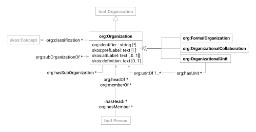

The [Organization Ontology](https://www.w3.org/TR/vocab-org/) is a W3C standard for describing organizational
structures, reporting relationships and membership. The vocabulary provides a framework for representing the structure
of organizations and their constituent parts, including formal and informal organizations, organizational units, and
relationships between people and organizations.

| prefix | namespace                            | description                                   |
|--------|--------------------------------------|-----------------------------------------------|
| org:   | http://www.w3.org/ns/org#            | [The Organization Ontology]                   |
| skos:  | http://www.w3.org/2004/02/skos/core# | [Simple Knowledge Organization System (SKOS)] |

# Organization

| term                                     | type                                          | #    | description                                                                                                   |
|------------------------------------------|-----------------------------------------------|------|---------------------------------------------------------------------------------------------------------------|
| [**org:Organization**][org-organization] | foaf:Organization                             |      | a collection of people organized together into a community or other social, commercial or political structure |
| [skos:prefLabel]                         | text                                          | 1    | preferred name of the organization                                                                            |
| [skos:altLabel]                          | string                                        | 0..1 | alternative name of the organization                                                                          |
| [skos:definition]                        | text                                          | 0..1 | statement of the nature and purpose of the organization                                                       |
| [org:classification]                     | [skos:Concept]                                | *    | categories classifying the organization                                                                       |
| [org:subOrganizationOf]                  | [org:Organization][organization]              | *    | organizations the organization is part of                                                                     |
| [org:hasSubOrganization]                 | [org:Organization][organization]              | *    | organizations that are part of the organization                                                               |
| [org:hasUnit]                            | [org:OrganizationalUnit][organizational-unit] | *    | organizational units belonging to the organization                                                            |
| [org:hasMember]                          | foaf:Person                                   | *    | persons who are members of the organization                                                                   |
| org:hasHead                              | foaf:Person                                   | *    | persons leading the organization                                                                              |

> [!WARNING]
> Known deviation from standard:
>
> - `org:identifier` should be a typed literal; it is specified as string to ease interoperability with frontend
		applications

# Formal Organization

| term                         | type                             | # | description                                       |
|------------------------------|----------------------------------|---|---------------------------------------------------|
| [**org:FormalOrganization**] | [org:Organization][organization] |   | an organization recognized in legal jurisdictions |

# Organizational Collaboration

| term                                  | type                             | # | description                                       |
|---------------------------------------|----------------------------------|---|---------------------------------------------------|
| [**org:OrganizationalCollaboration**] | [org:Organization][organization] |   | a collaboration between two or more organizations |

# Organizational Unit

| term                                                   | type                             | #    | description                                              |
|--------------------------------------------------------|----------------------------------|------|----------------------------------------------------------|
| [**org:OrganizationalUnit**][class-organizationalunit] | [org:Organization][organization] |      | an organization that is part of some larger organization |
| [org:unitOf]                                           | [org:Organization][organization] | 1..* | organizations the unit belongs to                        |

[The Organization Ontology]: https://www.w3.org/TR/vocab-org/

[Simple Knowledge Organization System (SKOS)]: https://www.w3.org/TR/skos-reference/

[org-organization]: https://www.w3.org/TR/vocab-org/#org:Organization

[skos:prefLabel]: https://www.w3.org/TR/skos-reference/#preflabel

[skos:altLabel]: https://www.w3.org/TR/skos-reference/#altlabel

[skos:definition]: https://www.w3.org/TR/skos-reference/#definition

[org:classification]: https://www.w3.org/TR/vocab-org/#org:classification

[skos:Concept]: skos.md#concept

[org:subOrganizationOf]: https://www.w3.org/TR/vocab-org/#org:subOrganizationOf

[org:hasSubOrganization]: https://www.w3.org/TR/vocab-org/#org:hasSubOrganization

[organization]: #organization

[org:hasUnit]: https://www.w3.org/TR/vocab-org/#org:hasUnit

[organizational-unit]: #organizational-unit

[org:hasMember]: https://www.w3.org/TR/vocab-org/#org:hasMember

[**org:FormalOrganization**]: https://www.w3.org/TR/vocab-org/#class-formalorganization

[**org:OrganizationalCollaboration**]: https://www.w3.org/TR/vocab-org/#class-organizationalcollaboration

[class-organizationalunit]: https://www.w3.org/TR/vocab-org/#class-organizationalunit

[org:unitOf]: https://www.w3.org/TR/vocab-org/#org:unitOf
