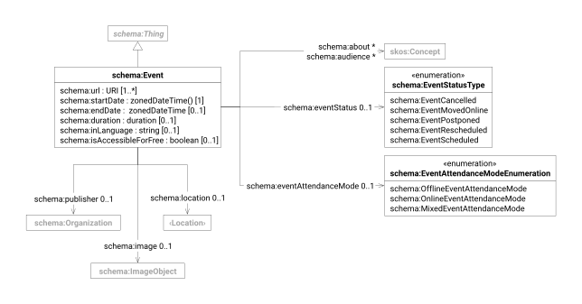

This document describes the [Schema.org](https://schema.org/docs/schemas.html) Event type and its properties used for
modeling events, meetings, conferences, and other time-based activities. These schemas enable structured representation
of event information for search engines and event applications.

| prefix  | namespace           | definition              |
|---------|---------------------|-------------------------|
| schema: | https://schema.org/ | [Schema.org] vocabulary |

| term                               | type                             | #    | description                                             |
|------------------------------------|----------------------------------|------|---------------------------------------------------------|
| **[schema:Event]**                 | [schema:Thing]                   |      | An event happening at a certain time and location       |
| [schema:name]                      | text                             | 0..1 | human-readable name of the event                        |
| [schema:disambiguatingDescription] | text                             | 0..1 | short account telling the event apart from similar ones |
| [schema:description]               | text                             | 0..1 | human-readable account of the event                     |
| [schema:image]                     | [schema:ImageObject]             | 0..1 | image depicting the event                               |
| [schema:url]                       | URI                              | 1..* | web pages describing the event                          |
| [schema:startDate]                 | dateTime                         | 1    | date and time at which the event starts                 |
| [schema:endDate]                   | dateTime                         | 0..1 | date and time at which the event ends                   |
| [schema:inLanguage]                | string                           | 0..1 | language the event is held in                           |
| [schema:isAccessibleForFree]       | boolean                          | 0..1 | flags events accessible free of charge                  |
| [schema:eventAttendanceMode]       | [EventAttendanceModeEnumeration] | 0..1 | mode of attendance offered by the event                 |
| [schema:eventStatus]               | [EventStatusType]                | 0..1 | current scheduling status of the event                  |
| [schema:publisher]                 | [schema:Organization]            | 0..1 | organization publishing the event                       |
| [schema:location][schema-location] | [schema:Location][location]      | 0..1 | physical or virtual location where the event is held    |
| [schema:keywords]                  | [skos:Concept]                   | *    | subject terms tagging the event                         |

[Schema.org]: https://schema.org/

[schema:Event]: https://schema.org/Event

[schema:Thing]: schema.md#thing

[schema:name]: https://schema.org/name

[schema:disambiguatingDescription]: https://schema.org/disambiguatingDescription

[schema:description]: https://schema.org/description

[schema:image]: https://schema.org/image

[schema:ImageObject]: schema.md#image-object

[schema:url]: https://schema.org/url

[schema:startDate]: https://schema.org/startDate

[schema:endDate]: https://schema.org/endDate

[schema:inLanguage]: https://schema.org/inLanguage

[schema:isAccessibleForFree]: https://schema.org/isAccessibleForFree

[schema:eventAttendanceMode]: https://schema.org/eventAttendanceMode

[EventAttendanceModeEnumeration]: https://schema.org/EventAttendanceModeEnumeration

[schema:eventStatus]: https://schema.org/eventStatus

[EventStatusType]: https://schema.org/EventStatusType

[schema:publisher]: https://schema.org/publisher

[schema:Organization]: schema.md#organization

[schema-location]: https://schema.org/location

[location]: schema.md#location

[schema:keywords]: https://schema.org/keywords

[skos:Concept]: skos.md#concept
