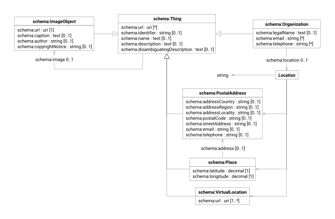

The [Schema.org](https://schema.org/docs/schemas.html) vocabulary provides a collection of schemas for structured data
markup of web pages. Schema.org defines types and properties for describing people, places, events, organizations,
products, and actions in a format understood by major search engines and other applications.

| prefix  | namespace           | definition              |
|---------|---------------------|-------------------------|
| schema: | https://schema.org/ | [Schema.org] vocabulary |

# Thing

> [!IMPORTANT]
>
> The `schema:Thing` data model is not intended for use in isolation: it factors the properties shared by the
> specialised [dataset](./index.md) models, which extend it with properties of their own.

| term                               | type                               | #    | description                                                   |
|------------------------------------|------------------------------------|------|---------------------------------------------------------------|
| **[schema:Thing][schema-thing]**   |                                    |      | the most generic type of item                                 |
| [schema:url]                       | URI                                | *    | web pages describing the resource                             |
| [schema:identifier]                | string                             | 0..1 | code identifying the resource within an identification scheme |
| [schema:name]                      | text                               | 0..1 | human-readable name of the resource                           |
| [schema:description]               | text                               | 0..1 | human-readable account of the resource                        |
| [schema:disambiguatingDescription] | text                               | 0..1 | short account telling the resource apart from similar ones    |
| [schema:image]                     | [schema:ImageObject][image-object] | 0..1 | image depicting the resource                                  |

> [!WARNING]
> Known deviation from standard:
>
> - `schema:identifier` should be a PropertyValue or URL; it is specified as string to ease interoperability with other
		vocabularies

# Organization

| term                               | type                  | #    | description                                                   |
|------------------------------------|-----------------------|------|---------------------------------------------------------------|
| **[schema:Organization]**          | [schema:Thing][thing] |      | an organization such as a school, NGO, corporation, club, etc |
| [schema:legalName]                 | string                | 0..1 | official registered name of the organization                  |
| [schema:email]                     | email                 | *    | email addresses of the organization                           |
| [schema:telephone]                 | phone                 | *    | telephone numbers of the organization                         |
| [schema:location][schema-location] | [Location]            | 0..1 | physical or virtual location of the organization              |

# Location

| term              | type                                       | #    | description                                 |
|-------------------|--------------------------------------------|------|---------------------------------------------|
| ‹String›          | string                                     | 0..1 | location as a free-form textual description |
| ‹PostalAddress›   | [schema:PostalAddress][postal-address]     | 0..1 | location as a postal address                |
| ‹Place›           | [schema:Place][place]                      | 0..1 | location as a place                         |
| ‹VirtualLocation› | [schema:VirtualLocation][virtual-location] | 0..1 | location as a virtual location              |

# Postal Address

| term                                              | type                  | #    | description                                          |
|---------------------------------------------------|-----------------------|------|------------------------------------------------------|
| **[schema:PostalAddress][schema-postal-address]** | [schema:Thing][thing] |      | the mailing address                                  |
| [schema:addressCountry]                           | string                | 0..1 | country the address lies in                          |
| [schema:addressRegion]                            | string                | 0..1 | region the address lies in                           |
| [schema:addressLocality]                          | string                | 1    | city or other locality the address lies in           |
| [schema:postalCode]                               | string                | 0..1 | code assigned to the address by the postal service   |
| [schema:streetAddress]                            | string                | 0..1 | street name and number of the address                |
| [schema:email]                                    | email                 | 0..1 | email address of the contact point at the address    |
| [schema:telephone]                                | phone                 | 0..1 | telephone number of the contact point at the address |

# Place

| term                             | type                                   | #    | description                                             |
|----------------------------------|----------------------------------------|------|---------------------------------------------------------|
| **[schema:Place][schema-place]** | [schema:Thing][thing]                  |      | entities that have a somewhat fixed, physical extension |
| [schema:address]                 | [schema:PostalAddress][postal-address] | 0..1 | postal address of the place                             |
| [schema:latitude]                | decimal                                | 1    | WGS84 latitude of the place                             |
| [schema:longitude]               | decimal                                | 1    | WGS84 longitude of the place                            |

# Virtual Location

| term                                                  | type                  | #    | description                                                |
|-------------------------------------------------------|-----------------------|------|------------------------------------------------------------|
| **[schema:VirtualLocation][schema-virtual-location]** | [schema:Thing][thing] |      | an online or virtual location for events and organizations |
| [schema:url]                                          | URI                   | 1..* | links to the virtual location                              |

# Image Object

| term                                          | type                  | #    | description                                    |
|-----------------------------------------------|-----------------------|------|------------------------------------------------|
| **[schema:ImageObject][schema-image-object]** | [schema:Thing][thing] |      | an image file                                  |
| [schema:url]                                  | URI                   | 1..* | links to the image file                        |
| [schema:caption]                              | text                  | 0..1 | text accompanying the image                    |
| [schema:author]                               | string                | 0..1 | creator of the image                           |
| [schema:copyrightNotice]                      | string                | 0..1 | statement of the copyright held over the image |

> [!WARNING]
>
> The `string` type for the `schema:author` property is known deviation from the *schema.org* definition, which
> specifies
`schema:Person` or `schema:Organization` values.

> [!TIP]
>
> The `schema:description` value may be used to provide an image description suitable for accessibility support, for
> instance through the alt attribute of the `img` HTML tag.

[Schema.org]: https://schema.org/

[schema-thing]: https://schema.org/Thing

[schema:url]: https://schema.org/url

[schema:identifier]: https://schema.org/identifier

[schema:name]: https://schema.org/name

[schema:description]: https://schema.org/description

[schema:disambiguatingDescription]: https://schema.org/disambiguatingDescription

[schema:image]: https://schema.org/image

[image-object]: #image-object

[schema:Organization]: https://schema.org/Organization

[thing]: #thing

[schema:legalName]: https://schema.org/legalName

[schema:email]: https://schema.org/email

[schema:telephone]: https://schema.org/telephone

[schema-location]: https://schema.org/location

[Location]: #location

[postal-address]: #postal-address

[place]: #place

[virtual-location]: #virtual-location

[schema-postal-address]: https://schema.org/PostalAddress

[schema:addressCountry]: https://schema.org/addressCountry

[schema:addressRegion]: https://schema.org/addressRegion

[schema:addressLocality]: https://schema.org/addressLocality

[schema:postalCode]: https://schema.org/postalCode

[schema:streetAddress]: https://schema.org/streetAddress

[schema-place]: https://schema.org/Place

[schema:address]: https://schema.org/address

[schema:latitude]: https://schema.org/latitude

[schema:longitude]: https://schema.org/longitude

[schema-virtual-location]: https://schema.org/VirtualLocation

[schema-image-object]: https://schema.org/ImageObject

[schema:caption]: https://schema.org/caption

[schema:author]: https://schema.org/author

[schema:copyrightNotice]: https://schema.org/copyrightNotice
